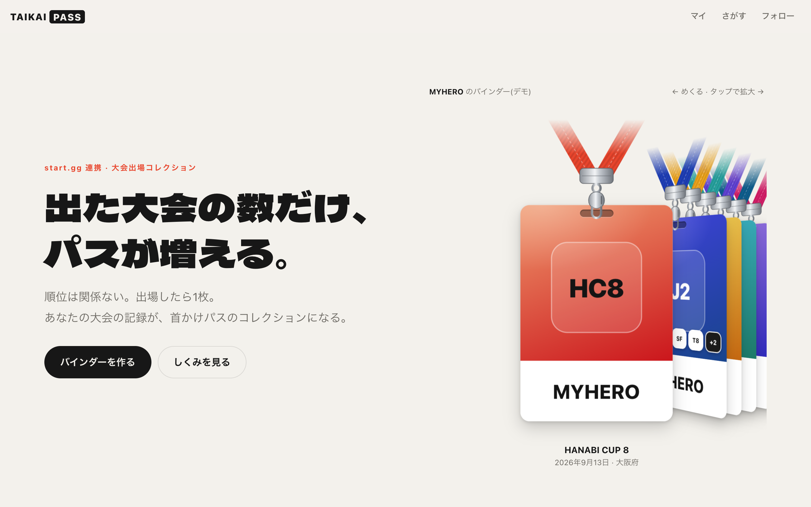
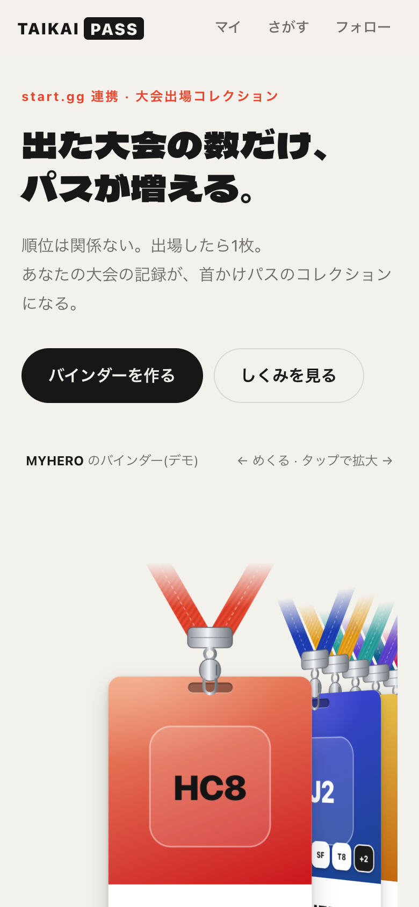
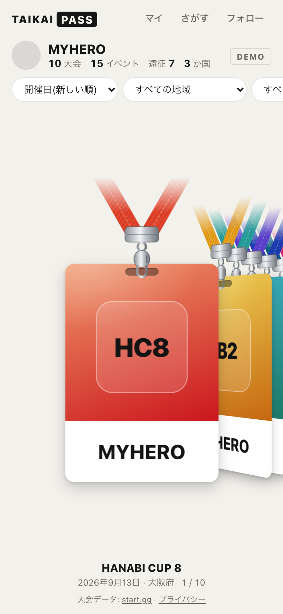
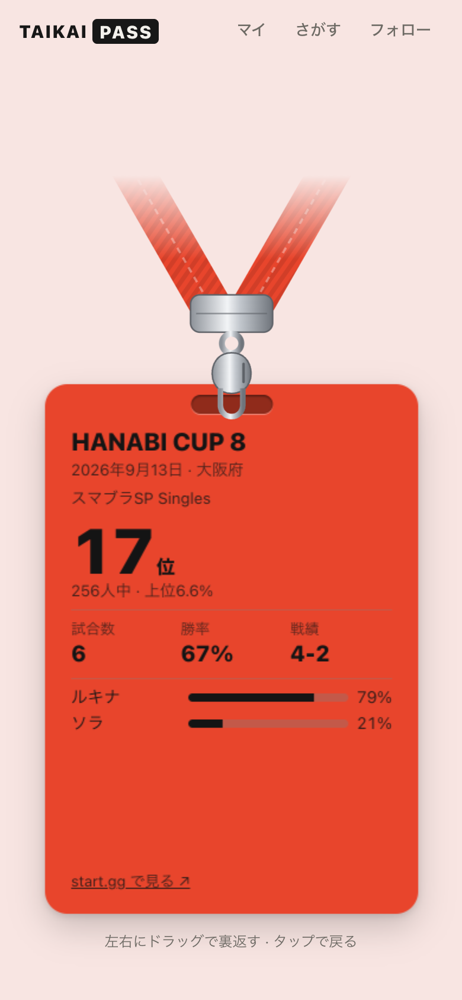

# TAIKAI PASS

出場した大会を「首かけパス」風のカードとして集めるアプリ。順位に関係なく、出場した大会ごとに1枚カードが発行される。データは start.gg の公開 GraphQL API から取得する。



| LP | バインダー | 裏返したところ |
| --- | --- | --- |
|  |  |  |

スクリーンショットはすべて架空のデモデータ(`/lp/demo`・`/demo`)。

## LP

**`/lp`**(ローカルなら http://localhost:3000/lp )

- ヒーローに実際に触れるカード一覧を置き、`src/config.ts` の `LP_FEATURED_SLUG` のプレイヤーの直近 `LP_CARD_COUNT` 大会を表示する
- ビルド時に start.gg から取得して静的生成し、1日ごとに裏で作り直す(ISR)。取得に失敗したときはデモデータで表示する
- **`/lp/demo`** は同じ LP を架空データで表示する(検索エンジンには載せない)
- スクリーンショットは `npm run dev` を起動した状態で `npm run screenshots` を実行すると `docs/screenshots/` に撮り直せる(インストール済みの Google Chrome を使用)。実在の選手・大会が写らないよう、デモデータのページだけを撮る

## セットアップ

```bash
npm install
cp .env.example .env.local   # STARTGG_TOKEN を記入
npm run check-schema          # 使うフィールドが start.gg に実在するか確認
npm run dev
```

- `/lp` … ランディングページ(`/lp/demo` はデモデータ版)
- `/privacy` … プライバシーポリシー(この端末のデータの削除ボタンあり)
- `/demo` … ダミーデータの UI 確認(トークン不要)
- `/` … 自分の start.gg プロフィール URL を登録してマイバインダー
- `/p/<user slug>` … 他プレイヤーのバインダー(閲覧のみ・フォロー可)
- `/following` … フォロー中のプレイヤーの出場タイムライン

## Vercel へのデプロイ

環境変数 `STARTGG_TOKEN`(必要なら `LOGO_MODE`)を設定してデプロイするだけ。
LP はビルド時に start.gg を呼ぶので、トークンは初回デプロイ前に設定しておくこと(未設定だとデモデータで生成され、次の再生成まで1日残る)。
API ルートのレスポンスは `Cache-Control: s-maxage` で CDN キャッシュされる(確定済みの大会でも最大1日)。

## 構成

```
src/
  config.ts                 除外リスト・ロゴ方針・テーマ色上書き・シリーズ定義(皆勤判定)
  lib/model/types.ts        ドメインモデル(PassCard など)
  lib/startgg/              GraphQL クエリ・クライアント(レート制限/再試行)・生レスポンス型
  lib/transform/            start.gg → PassCard の変換(純粋関数、テストあり)
    format.ts               シングルス判定(teamRosterSize + 変則フォーマット除外)・代表イベント選択
    region.ts               都道府県の表記ゆれ吸収 → 8地方区分
    sets.ts                 試合数・勝率(DQ除外)・使用キャラ比率
    theme.ts                ロゴからの代表色抽出・テーマ色一式の生成
    card.ts / stats.ts      カード組み立て・遠征/皆勤の集計
  lib/server/               API ルートから呼ぶ取得処理(sharp でロゴの色抽出)
  lib/client/               スプリング・ハプティクス・並び替え/絞り込み・localStorage
  components/CardStack.tsx  一覧/拡大/裏返しのインタラクション
  components/CardFaces.tsx  表面・裏面・首ストラップ
```

## 取得の流れ

1. `/api/players/:slug` … `user.tournaments` で参加大会の一覧だけを取る(軽量)
2. クライアントが大会ごとに `/api/cards/:tournamentId` を同時3本ずつ呼び、カードが1枚ずつ増えていく
3. 各カードは `tournament.events[].userEntrant` で出場イベントを特定し、タイトルごとの代表イベントだけ `entrant.paginatedSets` でセットを取る

確定済みのカードはブラウザの localStorage にも最大7日保存し、その間は API を呼ばない。

## start.gg API 規約への対応

[START.GG APIs Terms of Use](https://www.start.gg/about/apitos)(2025年2月14日更新版)に沿って、次のようにしている。

| 規約 | 対応 |
| --- | --- |
| 表示するコンテンツに start.gg の出典を示す(2章) | 各画面に「大会データ: start.gg」、カード裏に start.gg へのリンク |
| ロゴ・商標を削除・改変しない(2章) | 大会ロゴ・タイトルアイコンは切り抜かず全体を表示(`object-fit: contain`) |
| 必要最小限のデータだけ取得、用途に必要な範囲を超えてコピーしない(2章) | 表示する項目だけをクエリ。全選手を集めた検索用DBなどは作らない |
| トークンは1製品1つ、制限を回避しない(2章) | トークン1つ。サーバー側でレート制限内に収める |
| API のデータを広告のターゲティングに使わない(2章) | 使用しない(広告を載せる場合も同様) |
| データの扱いの説明(Privacy Statement)を用意する(4章) | `/privacy` |
| 保存データは start.gg 側の訂正・削除を反映し、不要になったら消す(4章) | CDN キャッシュ最大1日、端末キャッシュ最大7日。`/privacy` から端末のデータを削除できる |

公開前に `src/config.ts` で次を設定すること。

- `CONTACT` … プライバシーポリシーに載せる問い合わせ先(未設定だと「公開前に設定してください」と表示される)
- `BLOCKED_USER_SLUGS` … 掲載停止の依頼があったプレイヤー(バインダーと LP に表示されなくなる)
- `LP_FEATURED_SLUG` … LP で紹介するプレイヤー。実在の選手を使う場合は本人の了承を取る

大会ロゴの権利は各主催者にあり、この規約では許諾されない。許可を得た大会だけにする場合は `LOGO_MODE=allowlist` を使う。

## 未実装・今後

- **公開/非公開の切り替え**: ログインとDBが必要なため未実装。なお start.gg 上のデータ自体は公開なので、非公開にしてもこのアプリ上での表示を抑えるだけになる
- **フォロー・手動並び順**: 現状は端末の localStorage 保存。ログイン導入時にDBへ移す
- **タグ名検索**: start.gg 公開 API にプレイヤー検索がないため、プロフィール URL で指定する方式
- **皆勤判定**: start.gg にシリーズの概念がないため `src/config.ts` の `SERIES` に手動で登録する
- **予選/本戦が別イベントに分かれた大会**: 自動判定していない(代表イベントは参加者数最大のシングルス)
